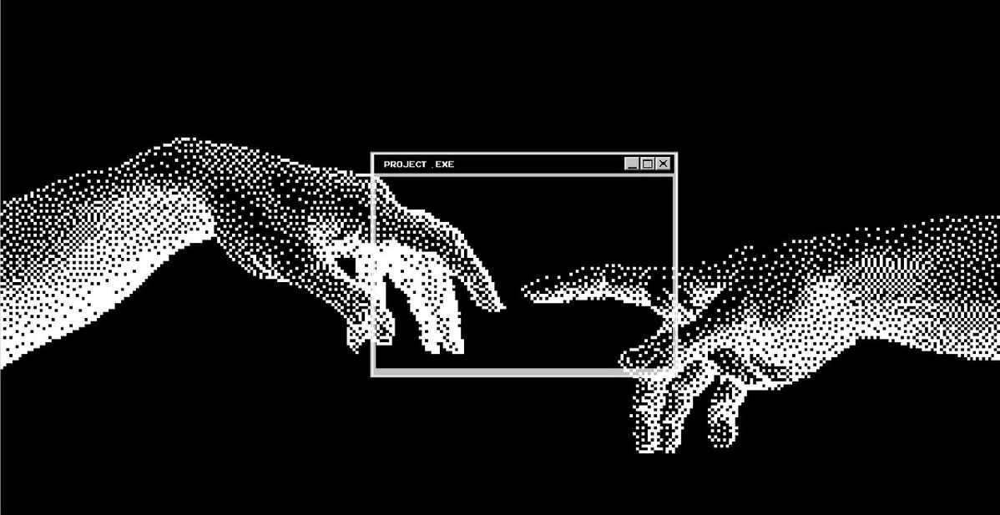

<h1 align="center">Hi 👋, I'm Jhon Mosquera</h1>

<h3 align="center">Frontend Developer</h3>

  

Creating fast, responsive and user-friendly interfaces with clean, maintainable code.

<h2 align="center">🚀 About Me</h2>

**Jhon**, here — a frontend developer focused on building modern, responsive and visually polished web interfaces.

I enjoy turning designs into real, fast and accessible websites, paying attention to every detail of the user experience.

Currently, I'm working with **Next.js, TypeScript and Tailwind CSS**, while improving my skills in **performance, responsive design and SEO**.

My goal is simple: write clean code, build products people enjoy using, and keep growing as a developer.

<h2 align="center">🤝 Connect</h2>

  
  
  

<h2 align="center">💻 Tech Stack</h2>

  

<h2 align="center">📊 GitHub Stats</h2>

 

<h2 align="center">📈 Activity Graph</h2>

